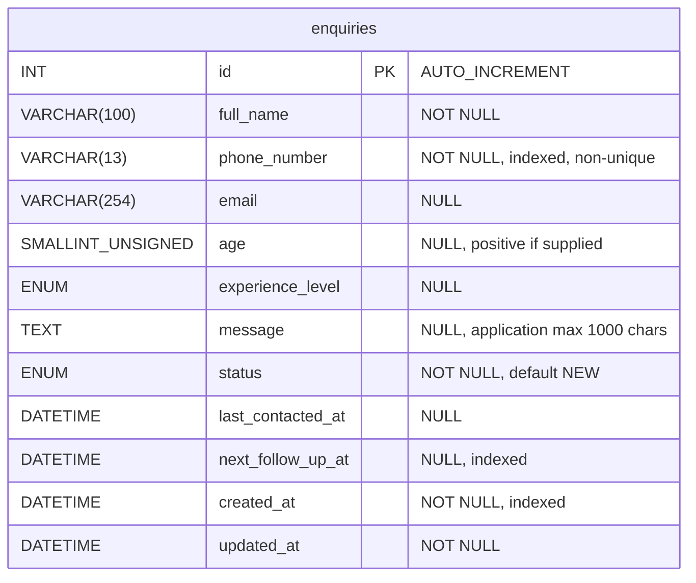

# StrumSpace — Enquiry Data Model & ERD

**Phase:** 2 — Enquiry Management (M2)  
**Task:** 2.2 — Enquiry Data Model and ERD  
**Status:** Design approved — implementation pending  
**Database:** MySQL 8.4 LTS (InnoDB)  
**Domain reference:** `docs/modules/enquiries/domain-rules.md`

---

## 1. Purpose and Scope

This document defines the approved physical database design for the enquiry module. It translates the business rules agreed in Task 2.1 into a single relational entity, including column definitions, constraints, indexes, timestamp conventions, and the incremental ERD.

SQLAlchemy model implementation, migration generation, and migration execution belong to Task 2.4. API schemas and contracts belong to Task 2.3.

## 2. Entity Design

**Table:** `enquiries`

Each row represents one enquiry submitted by a prospective student. An individual may submit multiple independent enquiries using the same mobile number. Each enquiry retains its own identifier, status, follow-up information, and timestamps.

No separate visitor, contact, status, experience, or follow-up table is required in M2. The `source` and `notes` fields are intentionally excluded.

### 2.1 Column definitions

| Column | MySQL type | Nullable | Default / generation | Purpose |
|---|---|---|---|---|
| `id` | INT | No | AUTO_INCREMENT | Unique enquiry identifier. |
| `full_name` | VARCHAR(100) | No | None | Prospective student's name. |
| `phone_number` | VARCHAR(13) | No | None | Normalized Indian mobile number. |
| `email` | VARCHAR(254) | Yes | NULL | Optional alternative contact. |
| `age` | SMALLINT UNSIGNED | Yes | NULL | Age in completed years, if provided. |
| `experience_level` | ENUM | Yes | NULL | Guitar-playing experience. |
| `message` | TEXT | Yes | NULL | Optional enquiry message; application limit of 1,000 characters. |
| `status` | ENUM | No | `NEW` | Current enquiry status. |
| `last_contacted_at` | DATETIME | Yes | NULL | Most recent contact time. |
| `next_follow_up_at` | DATETIME | Yes | NULL | Planned next follow-up time. |
| `created_at` | DATETIME | No | Application-generated | Record creation time. |
| `updated_at` | DATETIME | No | Application-generated | Most recent record modification time. |

### 2.2 Column design considerations

- Integer auto-increment IDs are sufficient for the current scope. IDs do not establish visitor ownership or authorize access.
- Phone numbers are strings, not numeric quantities. The canonical value `+919876543210` is 13 characters long.
- Email and mobile numbers are not unique across enquiry records.
- Age must be a positive integer if provided. The selected unsigned storage type has a technical upper bound of 65,535; this is not an academy eligibility rule. Input validation must reject values outside the column's representable range.
- The message uses TEXT for free-form content, with a maximum of 1,000 characters enforced by application validation. A separate database length check is not required at this stage.
- Optional values are stored as NULL when absent. API semantics for clearing optional fields are defined in Task 2.3.

## 3. Enumerated Values

Both enumerated columns use native MySQL ENUM types, supported by corresponding Python enums for application validation. MySQL strict SQL mode should be enabled so invalid enum values are rejected rather than silently coerced.

### 3.1 Enquiry status

| Value | Meaning |
|---|---|
| `NEW` | Enquiry received but not yet contacted. |
| `CONTACTED` | The academy has contacted the prospect. |
| `INTERESTED` | The prospect has expressed interest. |
| `NOT_INTERESTED` | The prospect has declined. |
| `CLOSED` | Enquiry is no longer actively pursued. |

The database default and application creation behavior both use `NEW`. Visitors cannot set the initial status or change it. The internal team may select any valid status from any current status. No transition matrix or database transition constraint is required.

A visitor cannot update a closed enquiry. A new enquiry creates a separate record; it does not alter the status or data of earlier enquiries. The internal team can reopen a closed enquiry. These actor-dependent rules belong in the application layer, not the ENUM definition.

### 3.2 Experience level

- `BEGINNER`
- `INTERMEDIATE`
- `ADVANCED`

This field is optional and defaults to NULL. Future additions to either ENUM require a reviewed schema migration and corresponding application changes. Trial-booking and student-conversion values are not included in M2.

## 4. Database Constraints

| Constraint | Field(s) | Rule |
|---|---|---|
| Primary key | `id` | Uniquely identifies each enquiry. |
| Auto-increment | `id` | Database generates the identifier. |
| NOT NULL | `id`, `full_name`, `phone_number`, `status`, `created_at`, `updated_at` | Required values cannot be NULL. |
| Native ENUM | `status`, `experience_level` | Restricts values to the approved vocabulary; experience may be NULL. |
| CHECK — positive age | `age` | `age > 0` when supplied; NULL remains valid. |
| CHECK — canonical mobile | `phone_number` | Exactly `+91` followed by ten ASCII digits, the first national digit being 6–9. |

The mobile-number check describes the required stored format. Its exact MySQL-compatible expression will be written and verified in Task 2.4. Phone input normalization takes place in the application before persistence.

No additional UNIQUE constraints or foreign keys are required. In particular, `phone_number` must remain non-unique. Repeated-enquiry lookup is not a uniqueness rule.

Application validation additionally handles whitespace-only names, name/email/message length, email format, normalization, optional field semantics, and permitted actor-specific updates. Phone format validation is not ownership verification. Public access and editing require future authentication and authorization; until then, use local testing with synthetic data only.

## 5. Index Strategy

The primary key is indexed by MySQL. Create only the following three additional non-unique indexes initially:

| Index name | Column | Purpose |
|---|---|---|
| `ix_enquiries_phone_number` | `phone_number` | Find enquiries matching a normalized mobile number. |
| `ix_enquiries_created_at` | `created_at` | Support default ordering and creation-date filters. |
| `ix_enquiries_next_follow_up_at` | `next_follow_up_at` | Support upcoming and overdue follow-up queries. |

No separate indexes are initially required for status, experience level, name, email, updated time, or message. Revisit this decision based on actual query patterns and MySQL EXPLAIN results rather than indexing every searchable field. In particular, ordinary B-tree indexes do not generally accelerate arbitrary substring searches.

List ordering must be deterministic; use the primary key as a tie-breaker when sort values match. Exact sort semantics, including placement of NULL follow-up dates, are defined in Task 2.3.

## 6. Timestamp and Timezone Conventions

Use MySQL DATETIME for all four datetime columns, consistent with ADR-001 and the project-wide IST (`Asia/Kolkata`) convention.

DATETIME stores the supplied wall-clock date and time without retaining a timezone offset or automatically converting it. Stored values must therefore be interpreted as IST by the application.

- `created_at`: generated by the application on insertion and not editable through the API.
- `updated_at`: initialized on insertion and maintained by the application when the record is modified.
- `last_contacted_at` and `next_follow_up_at`: optional, internal-team-managed values.
- Ordinary status changes do not implicitly update the follow-up timestamps.

The Python/SQLAlchemy implementation must explicitly use the existing IST configuration and ensure all intended write paths maintain the system-managed timestamps. Database-level CURRENT_TIMESTAMP defaults and ON UPDATE timestamp clauses are not part of this design.

Example:

```text
Stored MySQL DATETIME: 2026-11-28 10:30:00
API representation:    2026-11-28T10:30:00+05:30
```

The exact API input and serialization contracts will be finalized in Task 2.3.

## 7. Entity Relationship Diagram (ERD)

The initial ERD contains a single business entity. The Mermaid diagram is embedded here to keep the schema and ERD together. `SMALLINT_UNSIGNED` denotes MySQL `SMALLINT UNSIGNED`; the full physical definitions and index names are specified above.



There are no inter-entity relationships or foreign keys in M2. The ERD will be extended incrementally when trial bookings (M3), student records (M4), and other entities are designed. No future tables, foreign keys, or placeholder entities will be created in this phase.

## 8. Migration and Implementation Considerations

Task 2.4 will implement the approved SQLAlchemy model under `app/modules/enquiries/` and create an Alembic migration using the existing Phase 1 infrastructure.

- Use the shared SQLAlchemy metadata and async session configuration.
- Maintain a single Alembic configuration and migration history for both databases.
- Review generated migrations before execution.
- Apply and verify the migration against `strumspace_test` first, including the column types, defaults, constraints, indexes, persistence, and downgrade behavior.
- Verify the target database identity before destructive testing. Do not run downgrade tests against the development database.
- Once verified, upgrade the development database `strumspace` using the same migration history. Leave the test database at the required schema revision before integration tests.
- Do not introduce Docker, authentication implementation, or unrelated infrastructure changes.

No model or migration is generated or executed during Task 2.2.

## 9. Task 2.2 Completion and Handoff

The approved design supports the Task 2.1 domain rules, defines all physical fields, relevant constraints and indexes, preserves IST conventions, and contains the initial incremental ERD.

After this document is saved in the repository, record the approved design and mark Task 2.2 complete in `.claude/phases/phase-2.md`.

**Next task:** 2.3 — Enquiry Schemas and API Contract. Define create, visitor/internal partial-update and response schemas, repeated-enquiry lookup and new-enquiry semantics, filtering, searching, sorting, pagination, and error responses. Actual authentication and authorization enforcement remains deferred to M9. No SQLAlchemy model or Alembic migration should be implemented until Task 2.4.
